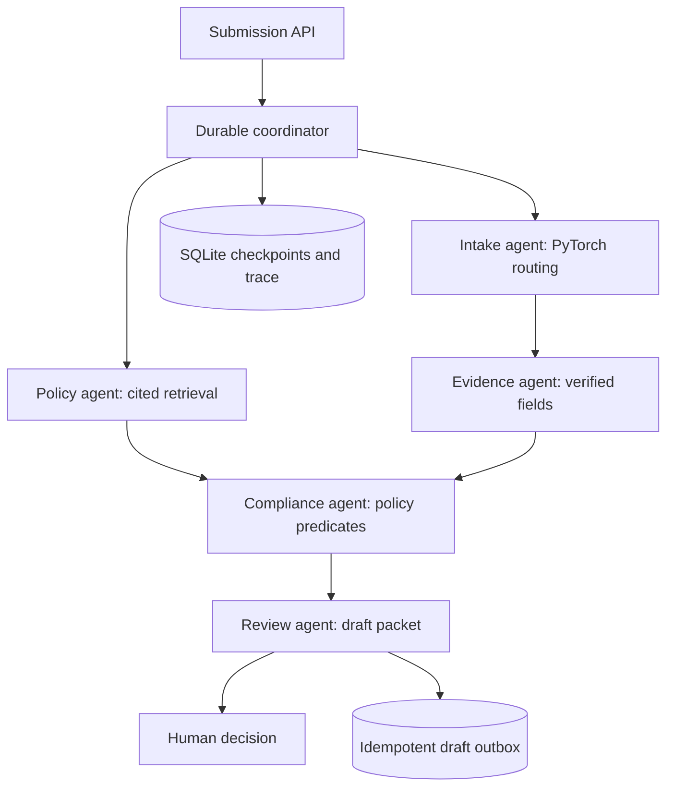

# Architecture and engineering decisions

ProcureFlow is a modular monolith: FastAPI, SQLite WAL, a PyTorch document router,
a small lexical policy index, explicit tool contracts, and a browser workbench.
It is intentionally runnable on a laptop. No external service is needed in offline mode.

## Agent behavior

Five named specialists expose real tools to the coordinator. In **offline** mode,
the coordinator schedules them deterministically, and field extraction uses supported
labels. This is a reproducible workflow, **not an LLM reasoning benchmark**.
In **live** mode an actual tool-calling LLM selects the next dependency-ready tool;
the evidence specialist asks the LLM for schema-constrained extractive facts. A tool
call can change workflow state, run retrieval, invoke the neural classifier, or create
a draft. The LLM cannot select arbitrary tools, change server-owned policy predicates,
approve a review, or send a message. Retrieval and extraction may occur in either
valid order, while checks require both. Maximum tool retries: 3. Maximum completed
workflow tools: 5. Each LLM HTTP call has a 25-second timeout. A provider instance permits at most
24 attempted requests and starts no new call after 240 seconds. Extraction retries
operate at the stage boundary rather than multiplying nested retry budgets.

The live extractor must return exact, unambiguous source substrings. The server
computes Unicode character offsets from these quotes. Invalid schemas, invented values, and invalid spans are rejected and
retried; exhaustion leaves a failed case that can be resumed. JSON extraction is
model-validated server-side; the endpoint need not support provider-specific strict
structured-output extensions. The HTTP adapter contract and alternate tool order
are tested with mocks; no live provider run is claimed in the bundled benchmark.

## PyTorch component

The model hashes word unigrams/bigrams with stable BLAKE2 hashes into 8,192 buckets,
learns 64-dimensional embeddings, mean-pools with EmbeddingBag, and applies a small
MLP. Cross-entropy and AdamW train all layers. Three seeds are reported. The checkpoint
and epoch are selected using validation loss. Temperature is selected on validation
loss; confidence below 0.55 abstains. This confidence is not a guarantee of correctness.

For this structured-text intake version, the selected type also needs at least two
recognized field labels. This **schema compatibility guard** can override a confident
prediction and route an attachment to manual review. Pure neural classifier scores
are reported separately from the guarded workflow. This prevents a confidently
misclassified newsletter from being treated as a partially valid offer. The system
does not force unsupported prose through a parser.

The keyword and TF-IDF logistic regression baselines receive the same training and
test texts. A neural model is not assumed to outperform a classical baseline.
Template families are split before examples are generated; file names do not encode
the class and are not classifier features. Synthetic development results cannot
establish transfer to real scanned documents or unseen institutions.

## Retrieval and rules

A TF-IDF index retrieves top-3 policy clauses with IDs, versions, scores, and policy
SHA-256. Retrieval is used for inspectable context, not to decide which mandatory
rules may be omitted. All configured predicates run against the authoritative policy.
Findings cite that policy directly, even if retrieval misses a clause. This avoids a
retrieval miss silently waiving a required check. The six-clause evaluation is small;
it demonstrates the plumbing, not enterprise retrieval scale.

## Persistence and failure boundaries

- Creation: unique idempotency key plus canonical submission SHA-256. Replays with
  changed content, policy, or execution mode return a conflict.
- Worker ownership: transactionally claimed 300-second lease and monotonic fencing
  token. Checkpoint and draft writes reject an expired or superseded worker.
- Checkpoint: each tool result, case revision, and completion event commit atomically.
- Drafts: `(case_id, kind)` is unique in a local outbox. A crash after the draft commit
  but before the workflow checkpoint can retry safely without another draft.
- Recovery: retryable errors use bounded exponential backoff. A new engine process
  resumes from committed steps once a crashed worker's lease expires.
- Human decisions: revision checks prevent stale decisions; outstanding findings
  block review approval. Clarification export requires a human-approved draft.
- External delivery: absent. There is no unsupported "exactly once email" claim.

The benchmark simulates process crashes after every tool, including after outbox
insertion. Accelerating lease expiry simulates elapsed time and does not measure
real failover time. SQLite is appropriate for this local prototype; a fleet of
workers would need a job queue, a shared transactional database, renewals during
long-running calls, tenant isolation, and operational load tests.

## Threat and deployment boundaries

Document contents are untrusted data. Live prompts explicitly separate evidence from
instructions; exact span validation and server-owned rules limit generated claims.
A small instruction-pattern detector flags known suspicious text. It is not a
complete prompt-injection defense. The UI uses textContent, not HTML interpolation.
CSP disallows inline scripts. Optional API and reviewer tokens are checked separately;
the reviewer name is an audit label, not verified identity. No SSO, RBAC directory,
CSRF cookie sessions, at-rest encryption, rate limiting, or tenancy is claimed.

The CLI binds to loopback. Compose exposes the service only on localhost. Use only
synthetic data by default. A real deployment needs HTTPS, verified user identities,
access controls, request/stream limits, audit retention, backups, and a deployment
review. Policy edits are file-managed and new cases are required after policy changes.

## Primary implementation references

- PyTorch EmbeddingBag: https://docs.pytorch.org/docs/stable/generated/torch.nn.EmbeddingBag.html
- FastAPI testing: https://fastapi.tiangolo.com/advanced/testing-dependencies/
- Function calling: https://developers.openai.com/api/docs/guides/function-calling

The project uses an explicit coordinator rather than an agent framework so tool
permissions, state transitions, retries, and failure boundaries remain inspectable.
